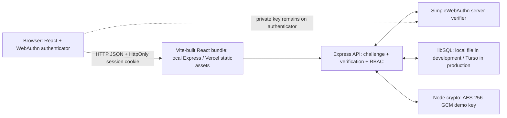

# Technical notes

## Architecture

Trust boundaries: the browser and submitted IDs are untrusted; Express loads role, ownership, course assignment and credential details from libSQL. Development uses a local database file; production uses Turso. WebAuthn challenges are generated and checked on the server. The browser receives only ceremony options and public response data. The private passkey key never goes to this app.

## Permission matrix

| Action | Student | Lecturer |
|---|---|---|
| Own profile and grades | Allow | Own profile only |
| Other student's grades | Deny | Students enrolled in a course assigned to that lecturer only |
| Assigned roster | Deny | Allow for the lecturer's assigned course |
| Edit grade | Deny | Assigned course only |
| Change roles | Deny | Deny |

The grade routes check the authenticated session first, then role, assignment/enrollment, and input. Student access is scoped to the signed-in ID. The client never supplies a trusted role. SQL values are parameterized. The seeded course catalog includes IS451, Operating Systems (CS230), Capstone Project (CS480), and Finance for Non-Finance Professionals (FIN101). A demo student can select courses during account creation and enroll in additional catalog courses after signing in. Public users can only receive the student role. New course enrollments do not fabricate grades; grades appear after a lecturer records them.

## WebAuthn and sessions

`npm run seed` creates random 144-bit one-time codes, stores SHA-256 hashes, and prints the plaintext once for local handoff. Codes expire in 48 hours and are checked against the requested pre-provisioned account. Registration options bind an account ID, RP ID, and server challenge; the server verifies origin, RP ID, and challenge using SimpleWebAuthn before storing credential ID, public key, counter, transports, device type and backup state. Authentication options are fresh and limited to credentials already associated with the requested account. The assertion is verified server-side before a session is regenerated and the account ID is placed in it.

The session ID is held in an HttpOnly, SameSite=Lax cookie; session data is stored in the same database as the app. Development uses a random in-memory process secret if `SESSION_SECRET` is absent, so restarting invalidates sessions. Production mode refuses to start without a configured secret and sets Secure cookies. State-changing routes require a CSRF token and matching Origin. Localhost HTTP is a browser secure context exception; the default development origin is `http://localhost:3000` with RP ID `localhost`. Production needs HTTPS, a real RP ID matching the domain, and an exact `ORIGIN` setting. Account recovery and code distribution are intentionally manual classroom procedures, not identity proofing. Vite watches and rebuilds the React bundle during `npm run dev`; Express serves the bundle and API locally. Vercel serves the built frontend from `public` and runs Express as a Function.

## AES-GCM

The Protected Academic Note page uses separate authenticated server routes to encrypt, decrypt, and test an altered copy of the exact note `Student consultation note – demonstration data only`. Encryption uses Node's `node:crypto`, AES-256-GCM, a 32-byte key and a fresh random 12-byte IV per encryption. The browser receives base64 ciphertext, IV and authentication tag; the key stays server-side. Without `AES_DEMO_KEY`, a fresh random key is generated on each process start, so ciphertext from one run cannot be decrypted after restart. A configured value must be base64 for exactly 32 bytes. Passkeys authenticate users; AES-GCM encrypts this demonstration string. Passkeys do not encrypt grades stored in SQLite.

## Limitations and deployment

This is a classroom prototype. The one-time code is not university identity verification. The app has no account recovery, credential revocation UI, rate limiting, production monitoring, key rotation, or production-grade secret manager. Local development stores data in a SQLite-compatible file; production data and sessions use Turso. Vercel requires the Turso URL and token, application secrets, and HTTPS/RP/origin settings. Do not deploy this build as an institutional records system.
